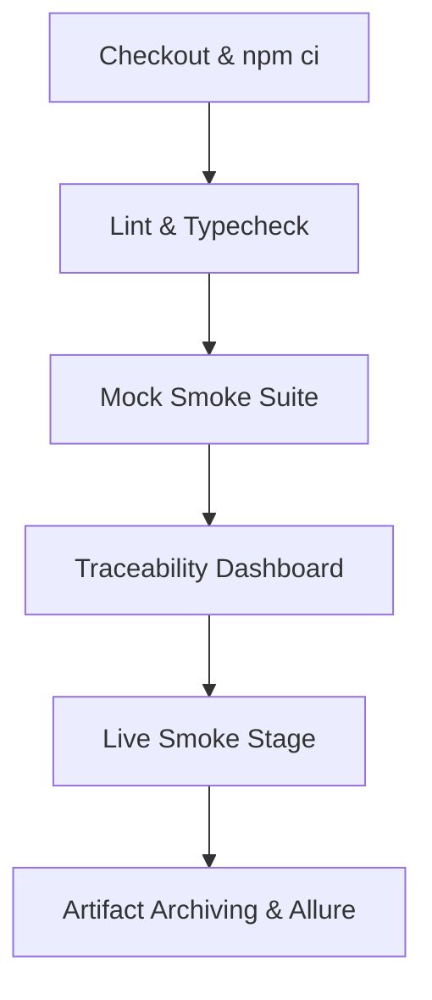

# Continuous Integration & Delivery Pipeline (`Jenkinsfile`)

This document defines the Jenkins CI/CD pipeline architecture, quality gate governance, agent configuration, and promotion criteria for the QA Automation framework.

---

## 1. Ownership & Governance Model (§15.1)

| Area                                    | Owner                  | Responsibility                                                                                             |
| --------------------------------------- | ---------------------- | ---------------------------------------------------------------------------------------------------------- |
| **Jenkins Infrastructure**              | DevOps                 | Jenkins master/controller, agent provisioning, plugin management, system uptime.                           |
| **Execution Environment**               | DevOps (on QA request) | Agent machine reachability, Docker runtime, Node 20 LTS, Playwright browser binaries.                      |
| **Pipeline Definition (`Jenkinsfile`)** | QA                     | Lives in repository root; maintained and versioned directly by QA without external tickets.                |
| **Test Stability & Results**            | QA                     | Suite determinism, flakiness eradication (< 2%), failure triage, and Allure maintenance.                   |
| **Deploy Gate Promotion**               | Lead QA + DevOps       | Joint sign-off to promote the smoke gate from report-only (`UNSTABLE`) to deployment-blocking (`FAILURE`). |

> **Core Principle:** _DevOps owns the machine; QA owns the job._

---

## 2. Pipeline Execution Stages

The declarative [`Jenkinsfile`](file:///c:/Users/HP/Desktop/NirikshaAG/Jenkinsfile) executes sequentially:



1. **Stage 1: Checkout & Clean Install (`npm ci`)**
   - Checks out the branch commit.
   - Installs locked dependencies from `package-lock.json` deterministically.
2. **Stage 2: Architectural Linting & Strict Typecheck**
   - Executes `npm run lint` to enforce all 5 custom architectural rules (§18.3).
   - Executes `npm run typecheck` across `@qa/core` and all project workspaces.
   - Any violation aborts the build immediately.
3. **Stage 3: Offline Self-Contained Smoke Suite (`MOCK=1`)**
   - Runs `MOCK=1 npm run test:smoke` against the local stub server.
   - Verifies all 15 core journeys in under 10 seconds. Serves as the framework's self-healing sanity check.
4. **Stage 4: Traceability & Coverage Dashboard**
   - Executes `npm run traceability`.
   - Reconciles test cases against workbook, validates zero orphan tests, and generates `traceability/dashboard.html`.
5. **Stage 5: Live Smoke Stage (Report-Only Gate)**
   - Triggered when target `ENV` and `SUITE` are passed as parameters.
   - Runs against the live environment.
   - Wrapped in `catchError(buildResult: 'UNSTABLE', stageResult: 'UNSTABLE')` during initial rollout (§D7).
6. **Post Execution: Archiving & Notifications**
   - Publishes Allure report aggregating Playwright and Cucumber outputs.
   - Archives screenshots, videos, trace files, and `traceability/dashboard.html` as persistent build artifacts.
   - Emits build status notifications.

---

## 3. Report-Only Gate & Promotion Policy (§D7)

### Why Report-Only Initially?

A newly deployed automation gate that immediately breaks deployment pipelines causes friction and is frequently turned off. We earn team trust first through proven stability before taking blocking authority.

### Gate Promotion Criteria

To promote the smoke gate from **UNSTABLE (Report-Only)** to **FAILURE (Deployment-Blocking)**:

1. **10 Consecutive Green Runs:** 10 consecutive smoke runs on CI against the real environment without false positives.
2. **Execution Time:** Entire smoke suite executes in **under 3 minutes** (current mock benchmark: ~8.9s).
3. **Flakiness Threshold:** Flaky test rate must be **under 2%**.
4. **Traceability Cleanliness:** Zero orphan tests reported by `npm run traceability`.

### Gate Promotion Log

| Date           | Environment |          Status          | Consecutive Passes | Flaky Rate | Approver |
| -------------- | ----------- | :----------------------: | :----------------: | :--------: | -------- |
| **2026-10-13** | `MOCK=1`    |       **VERIFIED**       |        10+         |    0.0%    | QA Lead  |
| _Pending_      | `uat`       | Report-Only (`UNSTABLE`) |       0 / 10       |     —      | —        |
| _Pending_      | `e2e`       | Report-Only (`UNSTABLE`) |       0 / 10       |     —      | —        |

---

## 4. DevOps Agent Request Specification (§15.2)

Submit the following specification to the DevOps infrastructure team for agent provisioning:

```yaml
Node Version: 20 LTS (Active)
Operating System: Ubuntu 22.04 LTS (Jammy)
Recommended Image: mcr.microsoft.com/playwright:v1.48.2-jammy
Agent Label: qa-playwright
Hardware Allocation: 4 vCPU, 8 GB RAM, 30 GB SSD
Network Reachability:
  - UAT Host: http://13.202.245.81:3000/
  - Target Backend API: http://13.202.245.81:8000/
  - Internal PostgreSQL (if dbChecks enabled): port 5432
Environment Secrets (Jenkins Credentials Store):
  - CAG_UAT_ADMIN_USER
  - CAG_UAT_ADMIN_PASSWORD
```
