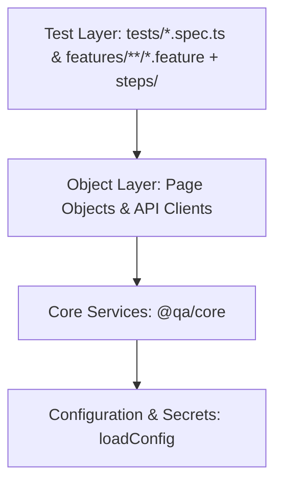

# Writing Tests in the QA Automation Framework

This guide documents the design principles, layering architecture, and concrete code patterns for contributing Page Objects, Components, BDD Features, and API specs to this repository.

---

## 1. The Four Strict Architectural Layers (§3, §7.3)

Every test must adhere to four strict layers. A layer may only import from layers below it:



1. **Config Layer**: Validates environment schemas and extracts credentials.
2. **Core Layer (`@qa/core`)**: Project-agnostic HTTP engine, browser factory, test data generator, cleanup registry, and assertions.
3. **Object Layer**: Page Objects, Component Objects, and typed API Clients. Runner-agnostic; **never asserts**.
4. **Test Layer**: Playwright specifications and Cucumber step definitions. **Assertions live exclusively here**.

---

## 2. Non-Negotiable Rules (Mechanically Enforced by ESLint)

Treat any violation of these rules as a build error:

1. **Page Objects and Component Objects NEVER Assert (§7.3)**
   - Page objects locate elements and trigger actions.
   - They return `Locator`, `Promise<string>`, or boolean state.
   - Assertions (`expect(...)`) belong exclusively in `steps/` and `tests/`.
2. **Zero Hardcoded URLs Outside `config/` and `mocks/` (§3, §18.3)**
   - All endpoint paths must be imported from `endpoints.ts`.
   - Never write `http://` or `https://` literals in test files.
3. **Deterministic Waits Only (§3, §80)**
   - `page.waitForTimeout()` and `setTimeout()` are strictly banned by ESLint.
   - Use condition-based deterministic waits (`toBeVisible()`, `pollUntil()`, `waitForResponse()`).
4. **Stable Locators Only (§3, §81)**
   - Priority order: `getByTestId()` &rarr; `getByRole()` &rarr; `getByLabel()`.
   - CSS class chains (`.btn.primary`), raw ID selectors (`#submit`), and XPath (`//div`) are banned.
5. **Packages/Core Project Agnosticism (§3)**
   - Code inside `packages/core` must **never** import from `projects/*`.
6. **Mandatory Traceability Tagging (§8.1, §12)**
   - Every scenario and spec must carry its workbook Test Case ID (e.g. `@TC:RA-01`).

---

## 3. How to Write a Page Object

Place page objects in `projects/<project>/src/pages/<domain>/<PageName>.ts`.

```typescript
import { Locator, Page } from '@playwright/test';
import { Header } from '../../components/Header';
import { Footer } from '../../components/Footer';

export class ReportsPage {
  public readonly header: Header;
  public readonly footer: Footer;

  constructor(private readonly page: Page) {
    this.header = new Header(page);
    this.footer = new Footer(page);
  }

  public async goto(): Promise<void> {
    await this.page.goto('/reports');
  }

  // Returns Locator — never asserts!
  public searchInput(): Locator {
    return this.page.getByTestId('public-reports-search-input');
  }

  public async search(keyword: string): Promise<void> {
    await this.searchInput().fill(keyword);
    await this.page.getByTestId('public-reports-search-submit').click();
  }
}
```

---

## 4. How to Write a Component Object

Place shared reusable UI components in `projects/<project>/src/components/<ComponentName>.ts`.

```typescript
import { Locator, Page } from '@playwright/test';

export class LanguageToggle {
  constructor(private readonly page: Page) {}

  public root(): Locator {
    return this.page.getByTestId('common-language-toggle');
  }

  public async selectLanguage(lang: 'en' | 'hi'): Promise<void> {
    await this.page.getByTestId(`common-lang-switch-${lang}`).click();
  }

  public async getCurrentLanguage(): Promise<string> {
    return (await this.page.getByTestId('common-lang-current').textContent()) ?? '';
  }
}
```

---

## 5. How to Write a Gherkin Feature & Step Definition

### Gherkin Feature File (`features/public/reports-search.feature`)

```gherkin
@ui @smoke
Feature: Reports Search
  As a citizen
  I want to search reports by keyword
  So that I can locate audits quickly

  @TC:RA-02
  Scenario: Keyword search returns matching records
    Given I navigate to the reports page
    When I search for reports with keyword "Direct Tax"
    Then all displayed report records should contain "Direct Tax"
```

### Step Definition (`steps/public/reports.steps.ts`)

```typescript
import { Given, When, Then } from '@cucumber/cucumber';
import { expect } from '@playwright/test';
import { CustomWorld } from '../../support/world';
import { ReportsPage } from '../../src/pages/public/ReportsPage';

Given('I navigate to the reports page', async function (this: CustomWorld) {
  if (!this.page) throw new Error('Page not initialized');
  const reports = new ReportsPage(this.page);
  await reports.goto();
});

When(
  'I search for reports with keyword {string}',
  async function (this: CustomWorld, keyword: string) {
    if (!this.page) throw new Error('Page not initialized');
    const reports = new ReportsPage(this.page);
    await reports.search(keyword);
  },
);

Then(
  'all displayed report records should contain {string}',
  async function (this: CustomWorld, keyword: string) {
    if (!this.page) throw new Error('Page not initialized');
    const reports = new ReportsPage(this.page);
    const rows = await reports.table.rows().all();
    for (const row of rows) {
      if (await row.isVisible()) {
        await expect(row).toContainText(keyword);
      }
    }
  },
);
```

---

## 6. How to Write an API Specification

Place API specs in `projects/<project>/tests/api/<specName>.spec.ts`.

```typescript
import { test, expect } from '@playwright/test';
import { ApiClient, assertSchema } from '@qa/core';
import { PublicApi } from '../../src/api/clients/PublicApi';
import { PaginatedReportsSchema } from '../../src/api/schemas';

test.describe('API Suite - Reports Endpoint', () => {
  test('[TC:API-02] GET /api/reports returns paginated reports @api @TC:API-02', async ({
    request,
  }) => {
    const client = new ApiClient({ requestContext: request, baseUrl: 'http://127.0.0.1:4000' });
    const publicApi = new PublicApi(client);

    const response = await publicApi.getReports({ page: 1, pageSize: 10 });

    expect(response.status).toBe(200);
    assertSchema(response.body, PaginatedReportsSchema);
    expect(response.body.data.page).toBe(1);
    expect(response.body.data.items.length).toBeGreaterThan(0);
  });
});
```
